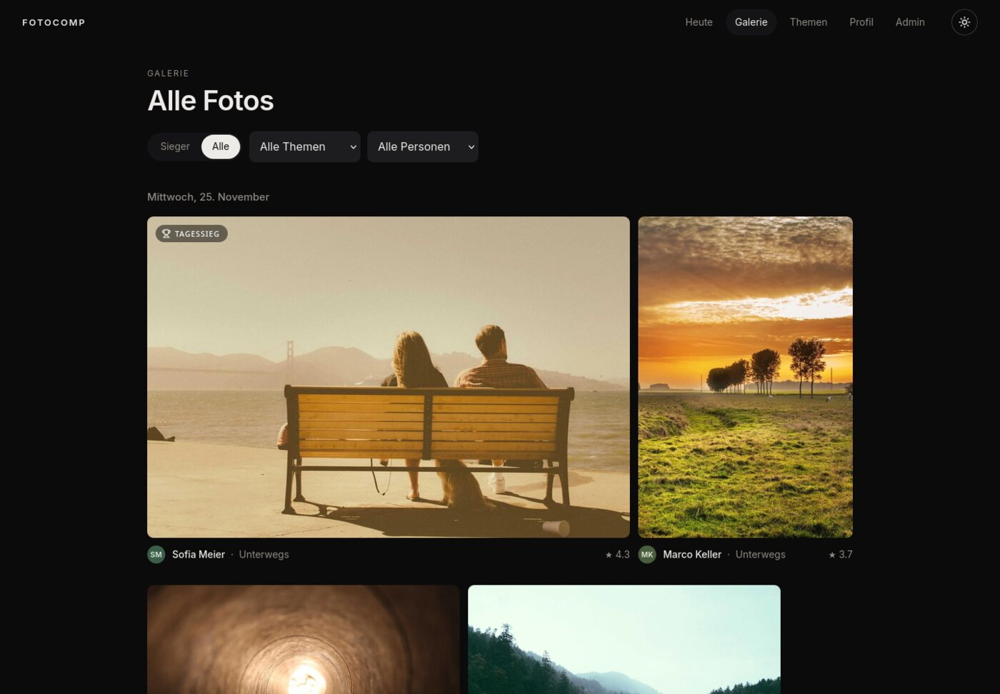
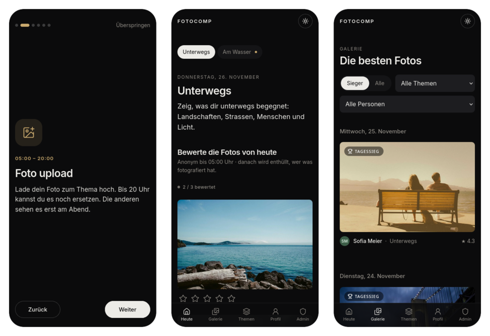

# Fotocomp

**Ein privater Foto-Wettbewerb unter Freunden – jeden Tag ein Foto, jeden Abend gegenseitig bewerten.**

Fotocomp ist eine kleine Web-App, die du selbst betreibst, zum Beispiel auf einem Synology NAS. Ihr wählt ein Thema wie «Unterwegs» oder «Am Wasser». Jeder lädt tagsüber sein bestes Foto dazu hoch. Am Abend bewerten alle die Fotos der anderen anonym mit Sternen, am Morgen wird enthüllt, wer gewonnen hat. Einmal pro Woche wird das Wochenfoto gekürt, und wer möchte, bekommt freundschaftliches Feedback.

Das Ziel: regelmässig fotografieren, voneinander lernen und dabei Spass haben. Ohne Werbung, ohne Algorithmus, ohne dass eure Fotos irgendwo anders landen.



<p align="center">
  
</p>
<p align="center"><sub>Auf dem Handy: kurze Einführung für neue Mitglieder · abends bewerten · die besten Fotos in der Galerie</sub></p>

## So funktioniert es

| Zeit (Europe/Zurich) | Was passiert                                                                                      |
| -------------------- | ------------------------------------------------------------------------------------------------- |
| 05:00 – 20:00        | Jeder lädt sein **Foto des Tages** hoch (ersetzen bis 20:00 möglich)                              |
| 20:00 – 05:00        | **Bewertung** mit 1–5 Sternen, anonym; das eigene Foto ist ausgenommen                            |
| 05:00                | **Enthüllung**: Rangliste mit Namen, danach beginnt der nächste Tag                               |
| Wochentag (z.B. So.) | **Wochenbewertung**: jeder wählt seine Top 3 der Woche, am nächsten Morgen gibt es das Wochenfoto |

Hat bis 20:00 Uhr im Thema niemand ein Foto hochgeladen, gibt es nichts zu bewerten. Dann ist der Upload für den nächsten Tag sofort offen (ausser vor dem Wochenbewertungstag und am letzten Tag eines Themas).

- **Themen** haben einen Titel und eine Beschreibung, dazu ein Enddatum oder sie laufen wiederkehrend. Mehrere Themen können parallel laufen, und jeder kann bei mehreren mitmachen. Auf der Startseite wechselt man oben per Reiter zwischen den eigenen Themen; ein Punkt zeigt, wo noch etwas zu tun ist.
- **Feedback**: Pro Foto lässt sich festlegen, ob Feedback willkommen ist. Feedback sieht nur der Fotograf. Zusätzlich gibt es **Feedback-Runden** pro Thema, automatisch (z.B. jeden Montag 19:00) oder von Hand gestartet.
- **Galerie**: Standardmässig die Tagessieger und Wochenfotos aller Themen, mit Badge. Auf Wunsch alle Fotos, gefiltert nach Thema und/oder Person.
- **Erinnerungen per Mail**: Pro Zeitpunkt höchstens eine Mail, auch bei mehreren Themen, und nie mehr als eine pro 30 Minuten. Oben steht eine persönliche Zeile, etwa neues Feedback, ein eigener Tagessieg oder eine Serie. Die Texte stehen in [`src/lib/mail-texts.ts`](src/lib/mail-texts.ts). Abschalten lassen sich die Erinnerungen im Profil.
- **Einführung**: Neue Benutzer sehen nach der ersten Anmeldung eine kurze Einführung in Schritten (zum Wischen) und wählen am Schluss genau ein Thema. Weitere Themen kommen später unter «Themen» dazu. Nachlesen geht jederzeit unter Profil → «So funktioniert Fotocomp».
- **Login ohne Passwort**: Login-Link oder 6-stelliger Code per Mail. Auf demselben Gerät bleibt man angemeldet (30 Tage gleitend).
- **Fotos**: JPEG, **HEIC** (iPhone), PNG, WebP, AVIF, TIFF und **RAW** (DNG inkl. iPhone ProRAW, CR2/CR3, NEF, ARW, RAF, ORF, RW2, PEF …) bis 200 MB. Bei RAW-Dateien wird die eingebettete Kamera-Vorschau verwendet, so sieht das Foto aus wie auf der Kamera; fehlt sie, wird das RAW mit LibRaw entwickelt. Die Originale werden unverändert nach Benutzer abgelegt. Für Handy, Monitor und Vollbild gibt es WebP-Thumbnails. Die Detailansicht zeigt Kamera, Objektiv, Belichtung, GPS und das Format des Originals.
- **Admin**: Der erste registrierte User ist Admin. Admins verwalten Benutzer, Fotos, Themen und Einstellungen und können weitere Admins ernennen. Die Admin-Übersicht zeigt die installierte Version.
- **Einladen** per Mail oder Link (Signal, WhatsApp, Matrix …) unter Profil → Freunde einladen.
- **Dunkelmodus** als Standard, auf Wunsch hell.

## Installation auf einem Synology NAS

Voraussetzung: DSM 7.2 oder neuer mit dem Paket **Container Manager**.

1. **Ordner anlegen** (File Station): `docker/fotocomp/photos` und `docker/fotocomp/db`.
2. **Einstellungen anlegen:** Die Vorlage [`nas.env.example`](nas.env.example) als `docker/fotocomp/.env` speichern und die Werte anpassen:
   - **Datenbank:** `DB_PASSWORD` als langes Zufallspasswort, nur aus Buchstaben und Ziffern. Zeichen wie `$` oder `#` verfälschen das Passwort. `DB_USERNAME` und `DB_DATABASE_NAME` können so bleiben.
   - **Adresse:** `ORIGIN` und `APP_PORT` (Port auf dem NAS, Standard 3000).
   - **Mail:** den SMTP-Zugang deines Mail-Anbieters. Port 587 oder 465, die Verschlüsselung wird passend gewählt.
   - **Updates:** `UPDATE_TOKEN` als langer Zufallstext, nur aus Buchstaben und Ziffern.
3. **Projekt erstellen:** Container Manager → Projekt → Erstellen.
   - Pfad: `/volume1/docker/fotocomp`
   - Quelle: «compose.yaml erstellen» und den Inhalt von [`compose.yaml`](compose.yaml) unverändert einfügen. Die Werte kommen alle aus der `.env`.
4. **HTTPS einrichten:**
   - Systemsteuerung → Sicherheit → Zertifikat: Let's-Encrypt-Zertifikat für deine Domain hinzufügen.
   - Systemsteuerung → Anmeldeportal → Erweitert → Reverse Proxy → Erstellen:
     - Quelle: `HTTPS`, Hostname `fotos.example.com`, Port `443`
     - Ziel: `HTTP`, `localhost`, Port wie `APP_PORT` (z.B. `3000`)
5. Die Adresse öffnen und **registrieren**. Der erste User wird automatisch Admin.

Nach einer Änderung an der `.env` das Projekt im Container Manager stoppen und wieder starten («Erstellen» übernimmt die neuen Werte).

Im Admin-Bereich kannst du die Registrierung danach auf «nur mit Einladung» stellen.

### Updates

1. Auf GitHub erscheint ein neues **Release** (z.B. `v0.4.0`). GitHub Actions baut daraus das Docker-Image (amd64 und arm64) unter `ghcr.io/dave281-ctl/fotocomp`.
2. Die App fragt stündlich bei GitHub nach der neuesten Version und entscheidet nach der Einstellung unter **Admin → Einstellungen → Updates**:
   - **Automatisch – alle Versionen** (Standard)
   - **Automatisch – nur innerhalb v0.x.x** bzw. **nur innerhalb v0.3.x**: Grössere Sprünge wartet die App ab. Die Bereiche richten sich nach der installierten Version.
   - **Manuell**: Die App zeigt nur an, dass es eine neue Version gibt.
3. Ist ein Update fällig, beauftragt die App **Watchtower**. Es lädt das neue Image und startet die App neu. Mit dem Knopf **«Jetzt aktualisieren»** geht das auch sofort, unabhängig von der Einstellung.
4. Beim Start werden Datenbank-Änderungen (Migrationen) ausgeführt, vorher legt die App automatisch eine Sicherung an (siehe unten).

Die installierte Version steht dezent unten auf jeder Seite.

**Versionsnummern:** Eine Erhöhung der mittleren Zahl (z.B. `0.3.x` → `0.4.0`) kündigt an, dass ein manueller Schritt nötig sein kann, etwa eine Änderung an `compose.yaml` oder `.env`. Was zu tun ist, steht dann in der Release-Notiz. Wer «nur innerhalb v0.3.x» wählt, bekommt solche Versionen nie unbemerkt.

**Lange nicht aktualisiert?** Kein Problem: Alle Datenbank-Änderungen bauen aufeinander auf und werden beim Start der Reihe nach ausgeführt. Ein Sprung von `v0.3.5` direkt auf die neueste Version funktioniert. Lies vorher die Release-Notizen der übersprungenen Versionen mit «⚠ Manueller Schritt».

> Nach dem allerersten Release muss das Paket einmalig öffentlich gemacht werden, damit das NAS es ohne Anmeldung laden kann: GitHub → Profil → Packages → `fotocomp` → Package settings → Change visibility → Public.

### Datensicherung

Alles Wichtige liegt in `/volume1/docker/fotocomp`. Am einfachsten sicherst du den Ordner mit **Hyper Backup**.

**Automatisch vor jedem Update mit Datenbank-Änderungen** legt die App eine Sicherung an, unter `docker/fotocomp/photos/backups/` (z.B. `fotocomp-2026-11-24-03-00-vor-v0.4.0.sql.gz`). Die fünf neuesten bleiben erhalten. Kann die Sicherung nicht erstellt werden (z.B. weil der Speicher voll ist), wird aus Sicherheit nicht migriert, und die App startet nicht. Das Log nennt dann den Grund.

Eine Sicherung **zurückspielen**, etwa nach einem missglückten Update:

1. Container Manager → Projekt `fotocomp` → Container `…-app-1` stoppen.
2. In `compose.yaml` bei `image:` die vorherige Version eintragen, z.B. `ghcr.io/dave281-ctl/fotocomp:0.3.5`, und die Update-Einstellung auf «Manuell» stellen, sobald die App wieder läuft.
3. Container `…-db-1` → Terminal → Erstellen → `bash`, dann (mit deinen Werten für Benutzer und Datenbank):
   ```bash
   dropdb -U fotocomp fotocomp && createdb -U fotocomp fotocomp
   zcat /pfad/zur/sicherung.sql.gz | psql -U fotocomp -d fotocomp
   ```
   Der `photos`-Ordner ist im db-Container nicht eingebunden. Am einfachsten kopierst du die Sicherung vorher mit der File Station nach `docker/fotocomp/db/` und verwendest den Pfad `/var/lib/postgresql/data/<datei>`.
4. Das Projekt wieder starten.

Für eine zusätzliche tägliche Datenbanksicherung legst du im Aufgabenplaner eine Aufgabe an:

```bash
docker exec fotocomp-db-1 pg_dump -U fotocomp fotocomp > /volume1/docker/fotocomp/backup.sql
```

Der Container-Name kann je nach Projektname abweichen (`docker ps` zeigt ihn an).

### Fehlerbehebung

**Die App startet und stoppt sofort, im Log steht `password authentication failed`.**
Postgres übernimmt `DB_USERNAME`, `DB_PASSWORD` und `DB_DATABASE_NAME` nur beim allerersten Start, also wenn der `db`-Ordner leer ist. Wurden die Werte in der `.env` danach geändert, passen sie nicht mehr zur bestehenden Datenbank. Es gibt zwei Lösungen:

- **Neu anfangen** (solange noch keine Daten drin sind): Projekt stoppen, den Inhalt von `docker/fotocomp/db` löschen, Projekt wieder starten.
- **Passwort in der Datenbank anpassen**: Container Manager → Container `…-db-1` → Terminal → Erstellen → `bash`, dann:
  ```bash
  psql -U fotocomp -d fotocomp -c "ALTER USER fotocomp PASSWORD 'dein-DB_PASSWORD-aus-der-env';"
  ```
  `fotocomp` steht hier für deinen `DB_USERNAME` bzw. `DB_DATABASE_NAME`. Danach das Projekt neu starten.

**Grosse Fotos (z.B. RAW) lassen sich nicht hochladen, die App meldet «zu gross für den Server».**
Dann begrenzt der Reverse Proxy die Grösse von Uploads. Die App selbst nimmt bis 200 MB an. Die Grenze der App lässt sich mit `MAX_UPLOAD_MB` in der `.env` ändern; für mehr als 200 MB zusätzlich `BODY_SIZE_LIMIT` (z.B. `310M`) setzen.

**Unter Einstellungen → Updates steht «Update-Steuerung nicht eingerichtet» oder «Watchtower ist nicht erreichbar».**
`UPDATE_TOKEN` fehlt in der `.env`, oder die `compose.yaml` stammt noch von vor v0.4.0. Beides wie im Abschnitt «Installation» ergänzen und das Projekt neu erstellen. Startet Watchtower nicht (im Log steht, dass ein Token nötig ist), fehlt ebenfalls `UPDATE_TOKEN`.

**Login-Mails kommen nicht an.**
Die App zeigt dann «Die Mail konnte nicht verschickt werden». Gleich nach dem Start schreibt sie ins Log, ob der Mailserver erreichbar ist (`Mailserver … erreichbar` oder `… nicht nutzbar` mit Grund, z.B. `EAUTH` für falsche Zugangsdaten oder `ETIMEDOUT` für einen falschen Host oder Port). Häufig passen Port und Verschlüsselung nicht zusammen: Port 465 nutzt TLS, Port 587 STARTTLS. Ein `SMTP_SECURE` wie in älteren Vorlagen ist nicht mehr nötig und sollte aus der `.env` entfernt werden.

### Ablage der Fotos

```
photos/
├─ originals/<benutzer>/<YYYY-MM-DD>_<thema>_<id>.<jpg|heic|dng|…>   unverändert, mit allen Metadaten
└─ thumbs/<id>/{480,1200,2400}.webp                      ohne Metadaten
```

## Entwicklung

Voraussetzungen: Node.js 22+, Perl (für ExifTool, unter Linux meist vorhanden) und Podman oder Docker. Für RAW-Dateien ohne eingebettete Vorschau optional LibRaw (`dcraw_emu`).

```bash
npm install
cp .env.example .env
npm run db:up        # PostgreSQL und Mailpit (Test-Mails unter http://localhost:8025)
npm run db:migrate
npm run dev          # http://localhost:5173
```

Mit `FAKE_NOW=2026-11-18T20:30` in der `.env` lässt sich die Uhrzeit simulieren (nur im Dev-Modus), z.B. um die Bewertung zu testen.

| Befehl                | Zweck                                     |
| --------------------- | ----------------------------------------- |
| `npm run check`       | TypeScript- und Svelte-Prüfung            |
| `npm run lint`        | Prettier und ESLint                       |
| `npm test`            | Unit-Tests (Zeitlogik, Punkte, Mailtexte) |
| `npm run db:generate` | Migration nach einer Schema-Änderung      |

### Aufbau

```
src/
├─ hooks.server.ts         Session, Hell/Dunkel, Hintergrund-Jobs
├─ lib/
│  ├─ schedule.ts          Phasen aus der Uhrzeit (getestet)
│  ├─ scoring.ts           Tages- und Wochenwertung (getestet)
│  ├─ mail-texts.ts        Texte der Erinnerungsmails (getestet)
│  ├─ components/          Feed, Vollbild, Sterne, Upload …
│  └─ server/              Datenbank, Auth, Fotos, Feedback, Mails
└─ routes/                 Heute, Galerie, Themen, Foto, Profil, Admin
```

### Technik

Alles ist Open Source: [SvelteKit](https://svelte.dev) (MIT), [Drizzle ORM](https://orm.drizzle.team) (Apache-2.0), [PostgreSQL](https://www.postgresql.org), [sharp](https://sharp.pixelplumbing.com) (Apache-2.0), [ExifTool](https://exiftool.org) über [exiftool-vendored](https://github.com/photostructure/exiftool-vendored.js) (MIT), [libheif](https://github.com/strukturag/libheif) über [heic-decode](https://github.com/catdad-experiments/heic-decode) (LGPL-3.0 / ISC), [LibRaw](https://www.libraw.org) (LGPL-2.1), [Nodemailer](https://nodemailer.com) (MIT-0), [date-fns](https://date-fns.org) (MIT), [Lucide](https://lucide.dev) (ISC), [Inter](https://rsms.me/inter/) (OFL), Karten von [OpenStreetMap](https://www.openstreetmap.org/copyright) und [Watchtower](https://github.com/nicholas-fedor/watchtower) (Apache-2.0).

Die Beispielfotos in den Screenshots stammen von [Unsplash](https://unsplash.com) (über [Lorem Picsum](https://picsum.photos)), u.a. von Austin Neill, Charlie Foster, Elias Carlsson, Luke Chesser, Paul Jarvis und Vadim Sherbakov.

## Lizenz

[MIT](LICENSE)
